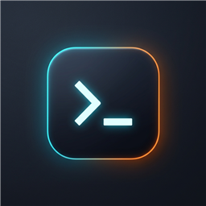
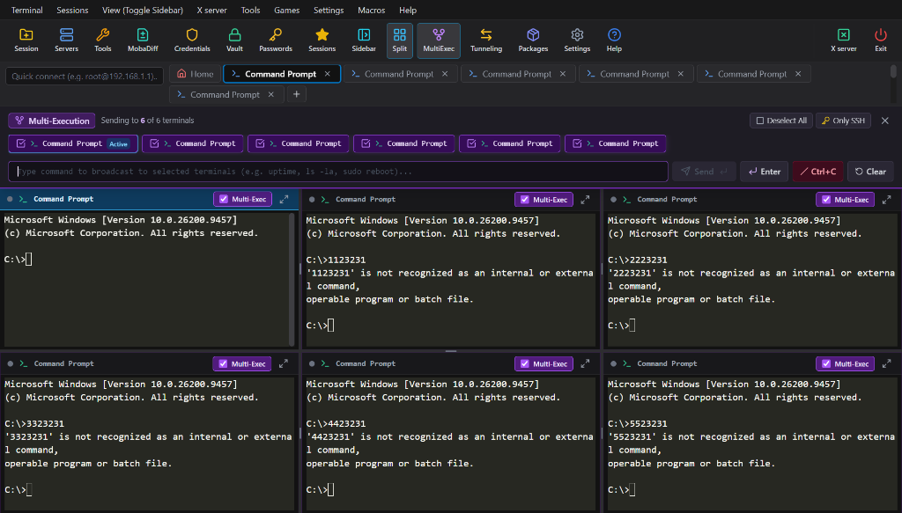
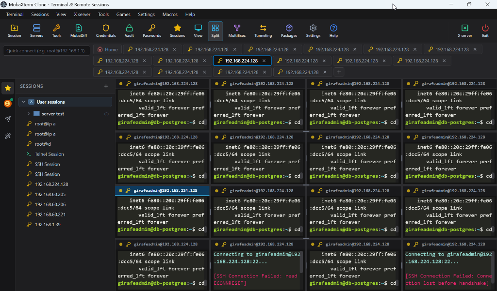
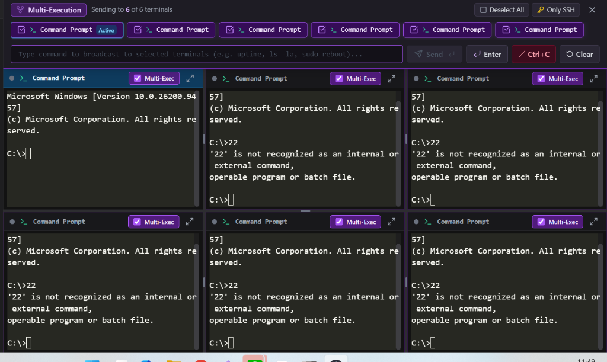

# KirinTerminal 🚀

<div align="center">



### **All-in-One Terminal & Remote Sessions Client for Windows**
*ทางเลือกใหม่สำหรับวิศวกรและผู้ดูแลระบบ — เร็ว สะอาด ครบวงจร (MobaXterm Alternative)*

[](https://github.com/jakkitsno-dot/KirinTerminal/releases/tag/v1.0.0)
[](LICENSE)
[](https://github.com/jakkitsno-dot/KirinTerminal/releases)

</div>

---

## 📥 ดาวน์โหลดโปรแกรมใช้งานทันที (Direct Download)

สำหรับผู้ใช้งานทั่วไป **ดาวน์โหลดแล้วดับเบิ้ลคลิกใช้งานได้ทันที 100%** ไม่ต้องติดตั้ง Node.js หรือคอมไพล์โค้ด:

| รูปแบบไฟล์ | ลิงก์ดาวน์โหลดตรง | ขนาด | คำแนะนำการใช้งาน |
| :--- | :--- | :---: | :--- |
| **📦 ตัวติดตั้งมาตรฐาน (Setup)** | [📥 **ดาวน์โหลด KirinTerminal.Setup.1.0.0.exe**](https://github.com/jakkitsno-dot/KirinTerminal/releases/download/v1.0.0/KirinTerminal.Setup.1.0.0.exe) | ~87 MB | **แนะนำเป็นหลัก:** ติดตั้งง่าย มี Shortcut บน Desktop และเปิดได้ทันทีใน 1-2 วินาที |
| **⚡ ตัวพกพา (Portable)** | [📥 **ดาวน์โหลด KirinTerminal.1.0.0.exe**](https://github.com/jakkitsno-dot/KirinTerminal/releases/download/v1.0.0/KirinTerminal.1.0.0.exe) | ~87 MB | **สำหรับพกพา:** ไม่ต้องติดตั้ง ดับเบิ้ลคลิกใช้งานได้ทันที เหมาะใส่ Flash Drive |

> 💡 *หมายเหตุสำหรับการเปิดครั้งแรก:* หาก Windows แจ้งเตือน SmartScreen ("Windows protected your PC") ให้คลิก **"More info"** แล้วกด **"Run anyway"** เพื่อเปิดใช้งานตามปกติ

---

## 📸 ภาพตัวอย่างโปรแกรมจริง (Screenshots)

### 1. หน้าจอหลักและระบบจัดการไฟล์ SFTP แบบเรียลไทม์ (Main Workspace & SFTP Browser)
เชื่อมต่อ SSH, Local Terminal, Serial Port พร้อมแถบจัดการไฟล์ SFTP ทางซ้ายมือ ลากวางอัปโหลดไฟล์ และดูสถานะเซิร์ฟเวอร์แบบเรียลไทม์


---

### 2. ฟีเจอร์แบ่งหน้าจออิสระ (Universal Split Grid View)
รองรับการแบ่งหน้าจอได้ทุกประเภทเซสชัน (Local Shell, SSH, Serial, Telnet, RDP, VNC, Network Tools) พร้อมปรับขนาดช่องได้อิสระ ลากปรับขนาด หรือ Maximize ดูเฉพาะจอได้ทันที


---

### 3. โหมดพิมพ์คำสั่งพร้อมกันหลายเซสชัน (Multi-Execution Mode)
พิมพ์คำสั่งเดียว ส่งออกไปยังทุกเซสชันที่เลือกไว้พร้อมกันทันที เหมาะสำหรับผู้ดูแลระบบที่ต้อง Deploy หรืออัปเดตเครื่อง Server / Switch หลายเครื่องพร้อมกัน


---

## ✨ ฟีเจอร์เด่น (Key Features)

- 💻 **Multi-Protocol Terminal Workspace**:
  - **Local Shells**: Windows PowerShell, Command Prompt (CMD), WSL (Ubuntu/Debian)
  - **SSH Client**: เชื่อมต่อเซิร์ฟเวอร์ด้วยรหัสผ่านหรือ Private Key พร้อม SFTP Tree Browser แบบสองทิศทาง
  - **Serial Ports (COM)**: รองรับงานสื่อสารไมโครคอนโทรลเลอร์ (Arduino, ESP32, STM32) ปรับ Baud Rate, DTR, RTS ได้ครบถ้วน
  - **Telnet / Raw Sockets**: เชื่อมต่ออุปกรณ์ Network Switch, Router เก่าได้อย่างราบรื่น
- 🖥️ **Remote Desktop Suite**:
  - **RDP**: เชื่อมต่อ Windows Remote Desktop ในตัว
  - **VNC Viewer**: มอนิเตอร์หน้าจอ Linux / Raspberry Pi / Mac ผ่าน VNC
- 🔀 **SSH Tunneling & Port Forwarding**:
  - จัดการ Local, Remote, และ Dynamic (SOCKS5) Port Forwarding ผ่าน GUI คลิกเดียวเริ่ม/หยุดทำงาน
- ⚡ **Multi-Execution Broadcast**:
  - สวิตช์พิมพ์คำสั่งแบบ Broadcast กระจาย keystrokes สู่หลายเซสชันพร้อมกัน
- 🔒 **Master Password & AES-256 Vault**:
  - ระบบจัดเก็บรหัสผ่านความปลอดภัยสูง ป้องกันข้อมูลรั่วไหล พร้อมฟังก์ชัน Reset Vault และ Backup/Restore Sessions (JSON)
- 📝 **เครื่องมือพัฒนาในตัว (Built-in DevTools)**:
  - **Monaco Code Editor**: เปิดแก้ไขไฟล์บน Remote Server ได้ทันทีแบบไม่ต้องสลับโปรแกรม
  - **MobaDiff File Comparator**: เปรียบเทียบความต่างของไฟล์ 2 ฝั่ง (Side-by-side Diff)
  - **Network Scanner & Tools**: สแกน IP ในวงแลน, ตรวจจับพอร์ตเปิด (Port Scanner), Ping Sweep, Traceroute, DNS Lookup

---

## 🗺️ แผนงานพัฒนาต่อยอด (Future Roadmap)

| เวอร์ชัน | ฟีเจอร์ที่กำลังพัฒนา | รายละเอียดและประโยชน์ | สถานะ |
| :---: | :--- | :--- | :---: |
| **v1.1.0** | **XTerm WebGL / Canvas GPU Acceleration** | เรนเดอร์ตัวอักษรผ่านชิปการ์ดจอ (GPU) เพื่อเปิดดูไฟล์ Log ขนาดมหึมา (ระดับหลายร้อย MB) แบบ 60 FPS ลื่นไหล | 🔄 In Progress |
| **v1.1.0** | **Scrollback Buffer Setting** | เพิ่มตัวเลือกในหน้า Settings ให้ปรับความยาว Buffer ประวัติย้อนหลังได้ (1,000 ถึง 50,000 บรรทัด) เพื่อประหยัด RAM บนเครื่องสเปกต่ำ | 🔄 In Progress |
| **v1.1.0** | **Themes & Color Palettes** | เพิ่มธีมสีสำเร็จรูป เช่น Dracula, Solarized Dark, Monokai, Retro Green Matrix | 🔄 In Progress |
| **v1.2.0** | **Local Monaco Bundling (100% Offline)** | รวม Core Web Worker ของ Monaco Editor ไว้ในตัวติดตั้ง ไม่ต้องเชื่อมต่อ CDN ให้แก้ไขโค้ดได้สมบูรณ์แม้อยู่ในห้อง Server ที่ตัดเน็ต | 📋 Planned |
| **v1.2.0** | **Auto-Update System** | ระบบตรวจจับและแจ้งเตือนอัปเดตเวอร์ชันใหม่อัตโนมัติผ่าน GitHub Releases | 📋 Planned |
| **v1.3.0** | **Encrypted Session Cloud Sync** | ซิงค์รายการเซสชันข้ามเครื่องอย่างปลอดภัยผ่าน Private Gist หรือ WebDAV | 📋 Planned |
| **v1.3.0** | **Embedded X11 Forwarding** | รองรับการเปิด GUI Application ของ Linux ข้ามเครือข่ายผ่าน X11 Forwarding Bridge | 📋 Planned |

---

## 🛠️ สำหรับนักพัฒนา (Developer Guide)

หากต้องการนำโค้ดไปรันหรือพัฒนาต่อยอด:

```bash
# 1. โคลน Repository
git clone https://github.com/jakkitsno-dot/KirinTerminal.git
cd KirinTerminal

# 2. ติดตั้ง Dependencies
npm install

# 3. รันในโหมด Development
npm run dev

# 4. คอมไพล์เป็นไฟล์ติดตั้ง Windows (.exe)
npm run dist:win
```

---

## 📄 License

MIT License — พัฒนาและดูแลโดย [Jakkit](https://github.com/jakkitsno-dot)
